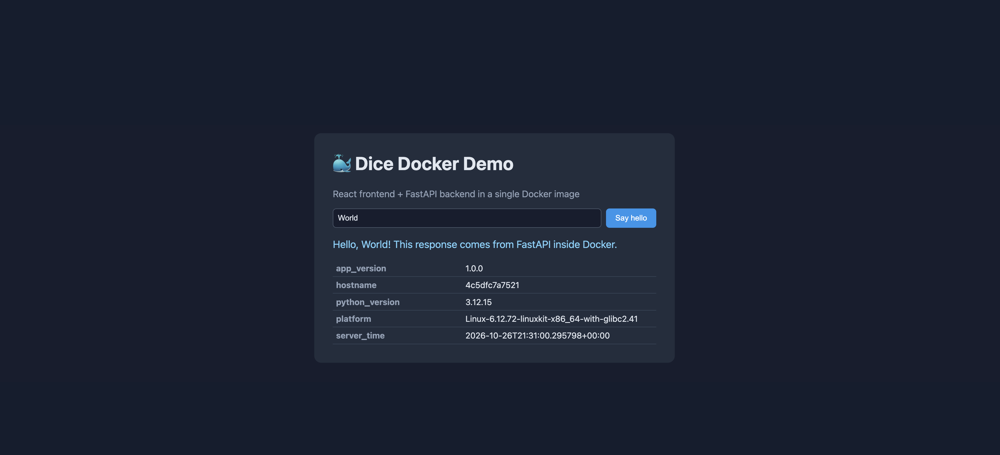
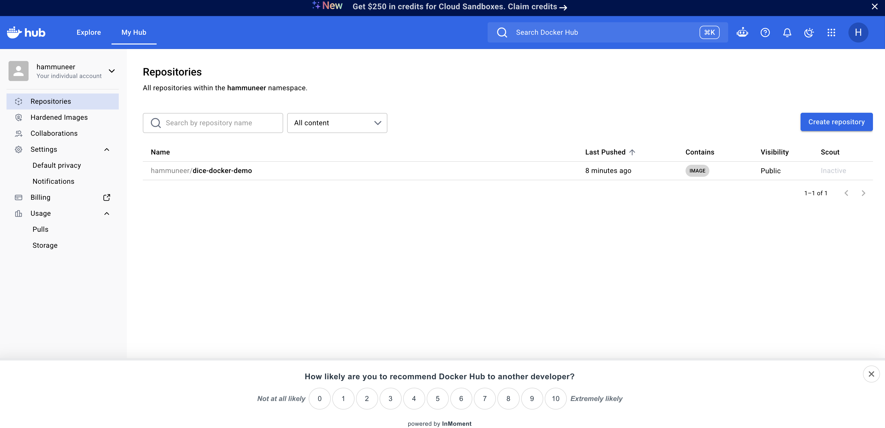

# Assignment 1 – Part 1: Dockerfile Creation, GitHub and Docker Hub Integration

**Author:** hammuneer
**GitHub repository:** https://github.com/hammuneer/dice-assignment1-part1-docker
**Docker Hub image:** https://hub.docker.com/r/hammuneer/dice-docker-demo

This repository contains a small full-stack web application (React frontend + FastAPI backend),
a Dockerfile that packages it into a single Docker image, and documentation of every command
used to build the image, push it to Docker Hub and push the code to GitHub.

### Quick start

```bash
docker run -d --name dice-app -p 8000:8000 hammuneer/dice-docker-demo:1.0.0
# then open http://localhost:8000
```

### Summary

| Step | Task | Marks | Result |
|------|------|-------|--------|
| 1 | Identify a sample application | 5 | React + FastAPI web app ([Step 1](#step-1--sample-application)) |
| 2 | Identify the dependencies | 5 | Runtimes, Python and npm packages listed ([Step 2](#step-2--dependencies)) |
| 3 | Create a Dockerfile | 15 | Multi-stage Dockerfile, lint check passes with no warnings ([Step 3](#step-3--dockerfile)) |
| 4 | Build the Docker image | 25 | Built with no errors; dependencies verified inside the image ([Step 4](#step-4--build-the-docker-image)) |
| 5 | Push the image to Docker Hub | 25 | `1.0.0` and `latest` pushed, publicly pullable ([Step 5](#step-5--push-the-docker-image-to-docker-hub)) |
| 6 | Create a GitHub repository | 10 | Public repo created with GitHub CLI ([Step 6](#step-6--create-a-github-repository)) |
| 7 | Include a README.md file | 15 | This document ([Step 7](#step-7--readmemd)) |
| 8 | Push the codebase to GitHub | 5 | Code pushed to `main` and verified ([Step 8](#step-8--push-the-codebase-to-github)) |

---

## Table of Contents

1. [Step 1 – Sample Application](#step-1--sample-application)
2. [Step 2 – Dependencies](#step-2--dependencies)
3. [Step 3 – Dockerfile](#step-3--dockerfile)
4. [Step 4 – Build the Docker Image](#step-4--build-the-docker-image)
5. [Step 5 – Push the Docker Image to Docker Hub](#step-5--push-the-docker-image-to-docker-hub)
6. [Step 6 – Create a GitHub Repository](#step-6--create-a-github-repository)
7. [Step 7 – README.md](#step-7--readmemd)
8. [Step 8 – Push the Codebase to GitHub](#step-8--push-the-codebase-to-github)

---

## Step 1 – Sample Application

The sample application is **Dice Docker Demo**, a minimal web app made of two parts:

| Part | Technology | Purpose |
|------|-----------|---------|
| Backend | Python **FastAPI** served by **Uvicorn** | Provides a small JSON API and serves the built frontend |
| Frontend | **React** built with **Vite** | A single page that calls the API and displays the results |

### API endpoints

| Method | Path | Description |
|--------|------|-------------|
| GET | `/api/health` | Health check – returns `{"status": "ok"}` |
| GET | `/api/hello?name=<name>` | Returns a greeting message for the given name |
| GET | `/api/info` | Returns container details: app version, hostname, Python version, platform, server time |
| GET | `/` | Serves the React single-page application |

### Project structure

```
assignment01_part01/
├── backend/
│   ├── main.py              # FastAPI application
│   └── requirements.txt     # Python dependencies
├── frontend/
│   ├── index.html           # HTML entry point
│   ├── package.json         # Node.js dependencies and build scripts
│   ├── package-lock.json    # Locked dependency versions
│   ├── vite.config.js       # Vite build configuration
│   └── src/
│       ├── main.jsx         # React entry point
│       ├── App.jsx          # Main React component
│       └── App.css          # Styles
├── Dockerfile               # Multi-stage image definition
├── .dockerignore            # Files excluded from the build context
├── logs/
│   ├── docker-build-check.log  # Output of the Dockerfile lint check
│   ├── docker-build.log     # Full output of docker build
│   ├── docker-login.log     # Output of docker login
│   ├── docker-push-*.log    # Output of docker push for each tag
│   ├── docker-remote-inspect.log, docker-anonymous-pull-check.log
│   ├── docker-rmi.log, docker-pull.log, docker-run-from-hub.log
│   ├── gh-repo-create.log, gh-repo-view.log
│   └── git-commit.log, git-push.log
├── screenshots/             # Browser and Docker Hub screenshots
├── .gitignore
└── README.md
```

### How it works

In production (inside Docker) the React app is compiled into static HTML/CSS/JS files,
and FastAPI serves those files at `/` while also answering API requests under `/api/*`.
This means the whole application runs as **one process, in one container, on one port (8000)**.

---

## Step 2 – Dependencies

The application has two groups of dependencies: those needed to **build** the frontend and
those needed to **run** the application. The Dockerfile uses a multi-stage build so that the
build-only tools (Node.js, npm, Vite) are not included in the final image.

### 2.1 Operating system and runtimes

| Dependency | Version | Needed for | Why |
|-----------|---------|-----------|-----|
| Linux (Debian slim / Alpine) | – | Build + run | Base operating system of the Docker images |
| **Node.js** + **npm** | 22 (LTS) | Build only | Installs frontend packages and runs the Vite build |
| **Python** | 3.12 | Run | Runs the FastAPI backend |
| **pip** | bundled with Python | Run | Installs Python packages from `requirements.txt` |

### 2.2 Python libraries (`backend/requirements.txt`)

| Package | Version | Purpose |
|---------|---------|---------|
| `fastapi` | 0.115.6 | Web framework used to define the API routes and serve static files |
| `uvicorn[standard]` | 0.34.0 | ASGI web server that runs the FastAPI app |

These packages bring in the following transitive dependencies (resolved by `pip`):

| Package | Pulled in by | Purpose |
|---------|-------------|---------|
| `starlette` | fastapi | Underlying ASGI toolkit (routing, `StaticFiles`) |
| `pydantic`, `pydantic_core` | fastapi | Data validation and serialization |
| `anyio`, `idna` | starlette | Async I/O support |
| `typing_extensions`, `annotated-types`, `typing-inspection` | pydantic | Type-hint helpers |
| `h11` | uvicorn | HTTP/1.1 protocol implementation |
| `click` | uvicorn | Command-line interface for `uvicorn` |
| `uvloop`, `httptools` | uvicorn[standard] | Faster event loop and HTTP parser |
| `websockets`, `watchfiles`, `python-dotenv`, `PyYAML` | uvicorn[standard] | WebSocket support, auto-reload, `.env` and YAML config loading |

### 2.3 Node.js packages (`frontend/package.json`)

| Package | Version | Type | Purpose |
|---------|---------|------|---------|
| `react` | 18.3.1 | dependency | UI library |
| `react-dom` | 18.3.1 | dependency | Renders React components in the browser |
| `vite` | 6.0.7 | devDependency | Build tool that bundles the frontend into static files |
| `@vitejs/plugin-react` | 4.3.4 | devDependency | Lets Vite compile JSX/React code |

### 2.4 Tools used on the host machine

| Tool | Version | Purpose |
|------|---------|---------|
| Docker | 29.2.1 | Build, run and push the image |
| Git | 2.50.1 | Version control |
| GitHub CLI (`gh`) | 2.101.0 | Create the GitHub repository from the terminal |

### 2.5 Command used to identify Python dependencies

**Command:**

```bash
pip install -r backend/requirements.txt
pip freeze
```

**Description:** `pip install` installs the packages listed in `requirements.txt`, and
`pip freeze` lists every installed package with its exact version, including transitive
dependencies.

**Output:**

```
annotated-types==0.8.0
anyio==4.15.1
click==8.5.0
fastapi==0.115.6
h11==0.16.0
httptools==0.9.0
idna==3.20
pydantic==2.14.1
pydantic_core==2.50.1
python-dotenv==1.2.4
PyYAML==6.0.3
starlette==0.41.3
typing-inspection==0.4.4
typing_extensions==4.16.0
uvicorn==0.34.0
uvloop==0.23.0
watchfiles==1.3.0
websockets==17.3
```

### 2.6 Command used to identify Node.js dependencies

**Command:**

```bash
cd frontend
npm install
npm ls --depth=0
```

**Description:** `npm install` downloads the packages listed in `package.json` and creates
`package-lock.json`; `npm ls --depth=0` lists the top-level packages that were installed.

**Output:**

```
added 61 packages in 12s

dice-docker-frontend@1.0.0 /Users/apple/Downloads/dice-course/assignment01_part01/frontend
├── @vitejs/plugin-react@4.3.4
├── react-dom@18.3.1
├── react@18.3.1
└── vite@6.0.7
```

---

## Step 3 – Dockerfile

The Dockerfile uses a **multi-stage build**:

- **Stage 1 (`frontend-build`)** uses Node.js to compile the React app into static files.
- **Stage 2 (`runtime`)** uses Python to run FastAPI, and copies in only the compiled
  frontend from stage 1. Node.js, npm and `node_modules` are left behind, which keeps the
  final image small.

### 3.1 Dockerfile

```dockerfile
# syntax=docker/dockerfile:1

# ---------- Stage 1: build the React frontend ----------
FROM node:22-alpine AS frontend-build

WORKDIR /frontend

# Install dependencies first so this layer is cached when only source code changes
COPY frontend/package.json frontend/package-lock.json ./
RUN npm ci

# Copy the frontend source and build static files into /frontend/dist
COPY frontend/ ./
RUN npm run build


# ---------- Stage 2: run the FastAPI backend ----------
FROM python:3.12-slim AS runtime

# Configuration: no .pyc files, unbuffered logs, no pip cache, app version
ENV PYTHONDONTWRITEBYTECODE=1 \
    PYTHONUNBUFFERED=1 \
    PIP_NO_CACHE_DIR=1 \
    PIP_ROOT_USER_ACTION=ignore \
    APP_VERSION=1.0.0

WORKDIR /app

# Install Python dependencies
COPY backend/requirements.txt ./
RUN pip install --upgrade pip && pip install -r requirements.txt

# Copy the backend source code and the built frontend from stage 1
COPY backend/ ./
COPY --from=frontend-build /frontend/dist ./static

# Run as a non-root user for better security
RUN useradd --create-home --uid 1000 appuser && chown -R appuser:appuser /app
USER appuser

EXPOSE 8000

# Mark the container unhealthy if the API stops responding
HEALTHCHECK --interval=30s --timeout=5s --start-period=10s --retries=3 \
    CMD python -c "import urllib.request; urllib.request.urlopen('http://localhost:8000/api/health')" || exit 1

# Command run when the container starts
CMD ["uvicorn", "main:app", "--host", "0.0.0.0", "--port", "8000"]
```

### 3.2 Explanation of each instruction

| Instruction | What it does |
|------------|--------------|
| `# syntax=docker/dockerfile:1` | Tells BuildKit to use the latest stable Dockerfile syntax |
| `FROM node:22-alpine AS frontend-build` | **Base image** for stage 1: Node.js 22 LTS on Alpine Linux (small, multi-architecture: amd64/arm64) |
| `WORKDIR /frontend` | Sets the working directory for the following instructions |
| `COPY frontend/package.json frontend/package-lock.json ./` | Copies only the dependency files first so the `npm ci` layer is cached between builds |
| `RUN npm ci` | **Installs dependencies** exactly as pinned in `package-lock.json` |
| `COPY frontend/ ./` | **Copies the frontend source code** into the build stage |
| `RUN npm run build` | Runs Vite to build the production files into `/frontend/dist` |
| `FROM python:3.12-slim AS runtime` | **Base image** for stage 2: Python 3.12 on Debian slim (multi-architecture: amd64/arm64) |
| `ENV PYTHONDONTWRITEBYTECODE=1 ...` | **Configuration:** don't write `.pyc` files, send logs straight to stdout (visible in `docker logs`), disable pip's cache to save space, silence pip's "running as root" warning (expected during an image build), set the app version |
| `WORKDIR /app` | Sets `/app` as the application directory |
| `COPY backend/requirements.txt ./` | Copies the Python dependency list first for layer caching |
| `RUN pip install --upgrade pip && pip install -r requirements.txt` | **Installs Python dependencies** (FastAPI, Uvicorn) |
| `COPY backend/ ./` | **Copies the backend source code** into the image |
| `COPY --from=frontend-build /frontend/dist ./static` | Copies the built React files from stage 1 into `/app/static`, where FastAPI serves them |
| `RUN useradd ... && chown ...` | **Configuration:** creates a non-root user `appuser` and gives it ownership of `/app` |
| `USER appuser` | Runs the container as the non-root user (security best practice) |
| `EXPOSE 8000` | Documents that the app listens on port 8000 |
| `HEALTHCHECK ...` | Every 30 s, calls `/api/health`; Docker marks the container `unhealthy` if it fails 3 times |
| `CMD ["uvicorn", "main:app", "--host", "0.0.0.0", "--port", "8000"]` | **Command run when the container starts:** launches Uvicorn on all interfaces, port 8000. The exec (JSON) form makes Uvicorn PID 1 so it receives stop signals directly |

### 3.3 `.dockerignore`

The `.dockerignore` file keeps unnecessary files out of the build context, which makes builds
faster and prevents local `node_modules` or build output from overwriting what is built inside
the image.

```
# Dependencies and build output are recreated inside the image
**/node_modules
frontend/dist
**/__pycache__
**/*.pyc
.venv

# Not needed in the image
.git
.gitignore
.dockerignore
Dockerfile
README.md
screenshots
.DS_Store
```

### 3.4 Validating the Dockerfile syntax

**Command:**

```bash
docker build --check .
```

**Description:** Parses the Dockerfile and runs Docker's built-in lint checks (build checks)
without building the image. It reports syntax errors and best-practice warnings. The output
below is from the final version of the Dockerfile (also saved in `logs/docker-build-check.log`).

**Output:**

```
#8 [internal] load metadata for docker.io/library/node:22-alpine
#8 DONE 1.7s

#9 [internal] load .dockerignore
#9 transferring context: 265B done
#9 DONE 0.0s
Check complete, no warnings found.
```

---

## Step 4 – Build the Docker Image

### 4.1 Build the image

**Command:**

```bash
docker build --progress=plain --no-cache \
  -t hammuneer/dice-docker-demo:1.0.0 \
  -t hammuneer/dice-docker-demo:latest .
```

**Description:** Builds an image from the `Dockerfile` in the current directory (`.`).

- `-t` tags the image. Two tags are applied: a fixed version (`1.0.0`) and `latest`. The
  `hammuneer/` prefix is the Docker Hub username, which is required to push it later.
- `--progress=plain` prints the full output of every step (useful for documentation).
- `--no-cache` forces every step to run from scratch, so the log shows the real installation
  of all dependencies.

**Output (summary of build steps):**

```
#1  [internal] load build definition from Dockerfile                 DONE 0.0s
#4  [internal] load metadata for docker.io/library/python:3.12-slim   DONE 0.8s
#5  [internal] load metadata for docker.io/library/node:22-alpine     DONE 0.8s
#6  [internal] load .dockerignore                                     DONE 0.0s
#7  [runtime 1/7] FROM docker.io/library/python:3.12-slim@sha256:a0f57064...
#9  [frontend-build 1/6] FROM docker.io/library/node:22-alpine@sha256:fe4f6d74...
#10 [frontend-build 2/6] WORKDIR /frontend
#13 [frontend-build 3/6] COPY frontend/package.json frontend/package-lock.json ./
#14 [frontend-build 4/6] RUN npm ci                                    DONE 4.5s
#16 [frontend-build 5/6] COPY frontend/ ./                             DONE 0.1s
#17 [frontend-build 6/6] RUN npm run build                             DONE 2.1s
#8  [runtime 2/7] WORKDIR /app
#12 [runtime 3/7] COPY backend/requirements.txt ./                     DONE 0.0s
#15 [runtime 4/7] RUN pip install --upgrade pip && pip install -r requirements.txt   DONE 24.0s
#18 [runtime 5/7] COPY backend/ ./                                     DONE 0.0s
#19 [runtime 6/7] COPY --from=frontend-build /frontend/dist ./static   DONE 0.0s
#20 [runtime 7/7] RUN useradd --create-home --uid 1000 appuser && chown -R appuser:appuser /app   DONE 0.2s
#21 naming to docker.io/hammuneer/dice-docker-demo:1.0.0 done
#21 naming to docker.io/hammuneer/dice-docker-demo:latest done
#21 DONE 3.3s
```

The build finished with exit code `0` and **no errors or warnings**. Both build stages ran:
`frontend-build` (6 steps) and `runtime` (7 steps).

<details>
<summary><b>Full build log</b> (click to expand – also saved in <code>logs/docker-build.log</code>)</summary>

```
#0 building with "desktop-linux" instance using docker driver

#1 [internal] load build definition from Dockerfile
#1 transferring dockerfile: 1.53kB done
#1 DONE 0.0s

#2 resolve image config for docker-image://docker.io/docker/dockerfile:1
#2 DONE 1.0s

#3 docker-image://docker.io/docker/dockerfile:1@sha256:4edf897a3ffa55b89f906fc8cc78afdb3f1834cc9c7083565e611a8a7d5fe99e
#3 resolve docker.io/docker/dockerfile:1@sha256:4edf897a3ffa55b89f906fc8cc78afdb3f1834cc9c7083565e611a8a7d5fe99e 0.0s done
#3 CACHED

#4 [internal] load metadata for docker.io/library/python:3.12-slim
#4 ...

#5 [internal] load metadata for docker.io/library/node:22-alpine
#5 DONE 0.8s

#4 [internal] load metadata for docker.io/library/python:3.12-slim
#4 DONE 0.8s

#6 [internal] load .dockerignore
#6 transferring context: 265B done
#6 DONE 0.0s

#7 [runtime 1/7] FROM docker.io/library/python:3.12-slim@sha256:a0f57064cbdcd6285fa45f51237ab0b35ea8ebaed06a1f5973e89e19dfb86704
#7 resolve docker.io/library/python:3.12-slim@sha256:a0f57064cbdcd6285fa45f51237ab0b35ea8ebaed06a1f5973e89e19dfb86704 0.0s done
#7 DONE 0.0s

#8 [runtime 2/7] WORKDIR /app
#8 CACHED

#9 [frontend-build 1/6] FROM docker.io/library/node:22-alpine@sha256:fe4f6d74e20370acb04ad889077d14d0f64a9c8ea6a42bc60cddf1e844699914
#9 resolve docker.io/library/node:22-alpine@sha256:fe4f6d74e20370acb04ad889077d14d0f64a9c8ea6a42bc60cddf1e844699914 0.0s done
#9 DONE 0.0s

#10 [frontend-build 2/6] WORKDIR /frontend
#10 CACHED

#11 [internal] load build context
#11 transferring context: 458B done
#11 DONE 0.0s

#12 [runtime 3/7] COPY backend/requirements.txt ./
#12 DONE 0.0s

#13 [frontend-build 3/6] COPY frontend/package.json frontend/package-lock.json ./
#13 DONE 0.0s

#14 [frontend-build 4/6] RUN npm ci
#14 4.195 
#14 4.195 added 61 packages, and audited 62 packages in 4s
#14 4.195 
#14 4.195 7 packages are looking for funding
#14 4.195   run `npm fund` for details
#14 4.225 
#14 4.225 2 vulnerabilities (1 moderate, 1 high)
#14 4.225 
#14 4.225 To address all issues, run:
#14 4.225   npm audit fix --force
#14 4.225 
#14 4.225 Run `npm audit` for details.
#14 4.227 npm notice
#14 4.227 npm notice New major version of npm available! 10.9.9 -> 12.2.1
#14 4.227 npm notice Changelog: https://github.com/npm/cli/releases/tag/v12.2.1
#14 4.227 npm notice To update run: npm install -g npm@12.2.1
#14 4.227 npm notice
#14 DONE 4.5s

#15 [runtime 4/7] RUN pip install --upgrade pip && pip install -r requirements.txt
#15 1.774 Requirement already satisfied: pip in /usr/local/lib/python3.12/site-packages (25.0.1)
#15 2.993 Collecting pip
#15 3.535   Downloading pip-26.2.2-py3-none-any.whl.metadata (4.6 kB)
#15 3.729 Downloading pip-26.2.2-py3-none-any.whl (1.8 MB)
#15 ...

#16 [frontend-build 5/6] COPY frontend/ ./
#16 DONE 0.1s

#15 [runtime 4/7] RUN pip install --upgrade pip && pip install -r requirements.txt
#15 4.725    ━━━━━━━━━━━━━━━━━━━━━━━━━━━━━━━━━━━━━━━━ 1.8/1.8 MB 3.1 MB/s eta 0:00:00
#15 4.744 Installing collected packages: pip
#15 4.744   Attempting uninstall: pip
#15 4.749     Found existing installation: pip 25.0.1
#15 4.787     Uninstalling pip-25.0.1:
#15 4.960       Successfully uninstalled pip-25.0.1
#15 5.964 Successfully installed pip-26.2.2
#15 ...

#17 [frontend-build 6/6] RUN npm run build
#17 0.355 
#17 0.355 > dice-docker-frontend@1.0.0 build
#17 0.355 > vite build
#17 0.355 
#17 0.693 vite v6.0.7 building for production...
#17 0.771 transforming...
#17 1.917 ✓ 27 modules transformed.
#17 2.043 rendering chunks...
#17 2.051 computing gzip size...
#17 2.058 dist/index.html                   0.40 kB │ gzip:  0.27 kB
#17 2.058 dist/assets/index-BKnbo-Yx.css    0.71 kB │ gzip:  0.41 kB
#17 2.058 dist/assets/index-BPRgs4Ta.js   144.33 kB │ gzip: 46.56 kB
#17 2.058 ✓ built in 1.33s
#17 DONE 2.1s

#15 [runtime 4/7] RUN pip install --upgrade pip && pip install -r requirements.txt
#15 8.961 Collecting fastapi==0.115.6 (from -r requirements.txt (line 1))
#15 9.500   Downloading fastapi-0.115.6-py3-none-any.whl.metadata (27 kB)
#15 9.754 Collecting uvicorn==0.34.0 (from uvicorn[standard]==0.34.0->-r requirements.txt (line 2))
#15 9.945   Downloading uvicorn-0.34.0-py3-none-any.whl.metadata (6.5 kB)
#15 10.17 Collecting starlette<0.42.0,>=0.40.0 (from fastapi==0.115.6->-r requirements.txt (line 1))
#15 10.34   Downloading starlette-0.41.3-py3-none-any.whl.metadata (6.0 kB)
#15 10.84 Collecting pydantic!=1.8,!=1.8.1,!=2.0.0,!=2.0.1,!=2.1.0,<3.0.0,>=1.7.4 (from fastapi==0.115.6->-r requirements.txt (line 1))
#15 11.01   Downloading pydantic-2.14.1-py3-none-any.whl.metadata (133 kB)
#15 11.43 Collecting typing-extensions>=4.8.0 (from fastapi==0.115.6->-r requirements.txt (line 1))
#15 11.60   Downloading typing_extensions-4.16.0-py3-none-any.whl.metadata (3.3 kB)
#15 11.79 Collecting click>=7.0 (from uvicorn==0.34.0->uvicorn[standard]==0.34.0->-r requirements.txt (line 2))
#15 11.96   Downloading click-8.5.0-py3-none-any.whl.metadata (2.6 kB)
#15 12.13 Collecting h11>=0.8 (from uvicorn==0.34.0->uvicorn[standard]==0.34.0->-r requirements.txt (line 2))
#15 12.30   Downloading h11-0.16.0-py3-none-any.whl.metadata (8.3 kB)
#15 12.52 Collecting httptools>=0.6.3 (from uvicorn[standard]==0.34.0->-r requirements.txt (line 2))
#15 12.69   Downloading httptools-0.9.0-cp312-cp312-manylinux1_x86_64.manylinux_2_28_x86_64.manylinux_2_5_x86_64.whl.metadata (3.5 kB)
#15 12.88 Collecting python-dotenv>=0.13 (from uvicorn[standard]==0.34.0->-r requirements.txt (line 2))
#15 13.05   Downloading python_dotenv-1.2.4-py3-none-any.whl.metadata (29 kB)
#15 13.28 Collecting pyyaml>=5.1 (from uvicorn[standard]==0.34.0->-r requirements.txt (line 2))
#15 13.45   Downloading pyyaml-6.0.3-cp312-cp312-manylinux2014_x86_64.manylinux_2_17_x86_64.manylinux_2_28_x86_64.whl.metadata (2.4 kB)
#15 13.67 Collecting uvloop!=0.15.0,!=0.15.1,>=0.14.0 (from uvicorn[standard]==0.34.0->-r requirements.txt (line 2))
#15 13.84   Downloading uvloop-0.23.0-cp312-cp312-manylinux2014_x86_64.manylinux_2_17_x86_64.manylinux_2_28_x86_64.whl.metadata (5.1 kB)
#15 14.12 Collecting watchfiles>=0.13 (from uvicorn[standard]==0.34.0->-r requirements.txt (line 2))
#15 14.30   Downloading watchfiles-1.3.0-cp310-abi3-manylinux_2_17_x86_64.manylinux2014_x86_64.whl.metadata (4.9 kB)
#15 14.64 Collecting websockets>=10.4 (from uvicorn[standard]==0.34.0->-r requirements.txt (line 2))
#15 14.81   Downloading websockets-17.3-cp312-cp312-manylinux1_x86_64.manylinux_2_28_x86_64.manylinux_2_5_x86_64.whl.metadata (6.3 kB)
#15 14.99 Collecting annotated-types>=0.6.0 (from pydantic!=1.8,!=1.8.1,!=2.0.0,!=2.0.1,!=2.1.0,<3.0.0,>=1.7.4->fastapi==0.115.6->-r requirements.txt (line 1))
#15 15.16   Downloading annotated_types-0.8.0-py3-none-any.whl.metadata (15 kB)
#15 16.31 Collecting pydantic-core==2.50.1 (from pydantic!=1.8,!=1.8.1,!=2.0.0,!=2.0.1,!=2.1.0,<3.0.0,>=1.7.4->fastapi==0.115.6->-r requirements.txt (line 1))
#15 16.48   Downloading pydantic_core-2.50.1-cp312-cp312-manylinux_2_17_x86_64.manylinux2014_x86_64.whl.metadata (6.5 kB)
#15 16.66 Collecting typing-inspection>=0.4.4 (from pydantic!=1.8,!=1.8.1,!=2.0.0,!=2.0.1,!=2.1.0,<3.0.0,>=1.7.4->fastapi==0.115.6->-r requirements.txt (line 1))
#15 16.83   Downloading typing_inspection-0.4.4-py3-none-any.whl.metadata (2.6 kB)
#15 17.02 Collecting anyio<5,>=3.4.0 (from starlette<0.42.0,>=0.40.0->fastapi==0.115.6->-r requirements.txt (line 1))
#15 17.19   Downloading anyio-4.15.1-py3-none-any.whl.metadata (4.7 kB)
#15 17.37 Collecting idna>=2.8 (from anyio<5,>=3.4.0->starlette<0.42.0,>=0.40.0->fastapi==0.115.6->-r requirements.txt (line 1))
#15 17.54   Downloading idna-3.20-py3-none-any.whl.metadata (7.2 kB)
#15 17.72 Downloading fastapi-0.115.6-py3-none-any.whl (94 kB)
#15 17.94 Downloading uvicorn-0.34.0-py3-none-any.whl (62 kB)
#15 18.13 Downloading pydantic-2.14.1-py3-none-any.whl (488 kB)
#15 18.64 Downloading pydantic_core-2.50.1-cp312-cp312-manylinux_2_17_x86_64.manylinux2014_x86_64.whl (2.2 MB)
#15 19.05    ━━━━━━━━━━━━━━━━━━━━━━━━━━━━━━━━━━━━━━━━ 2.2/2.2 MB 5.1 MB/s  0:00:00
#15 19.22 Downloading starlette-0.41.3-py3-none-any.whl (73 kB)
#15 19.40 Downloading anyio-4.15.1-py3-none-any.whl (132 kB)
#15 19.59 Downloading annotated_types-0.8.0-py3-none-any.whl (13 kB)
#15 19.76 Downloading click-8.5.0-py3-none-any.whl (125 kB)
#15 19.95 Downloading h11-0.16.0-py3-none-any.whl (37 kB)
#15 20.12 Downloading httptools-0.9.0-cp312-cp312-manylinux1_x86_64.manylinux_2_28_x86_64.manylinux_2_5_x86_64.whl (552 kB)
#15 20.18    ━━━━━━━━━━━━━━━━━━━━━━━━━━━━━━━━━━━━━━━━ 552.8/552.8 kB 11.0 MB/s  0:00:00
#15 20.35 Downloading idna-3.20-py3-none-any.whl (69 kB)
#15 20.52 Downloading python_dotenv-1.2.4-py3-none-any.whl (23 kB)
#15 20.69 Downloading pyyaml-6.0.3-cp312-cp312-manylinux2014_x86_64.manylinux_2_17_x86_64.manylinux_2_28_x86_64.whl (807 kB)
#15 20.78    ━━━━━━━━━━━━━━━━━━━━━━━━━━━━━━━━━━━━━━━━ 807.9/807.9 kB 9.8 MB/s  0:00:00
#15 20.95 Downloading typing_extensions-4.16.0-py3-none-any.whl (45 kB)
#15 21.13 Downloading typing_inspection-0.4.4-py3-none-any.whl (14 kB)
#15 21.30 Downloading uvloop-0.23.0-cp312-cp312-manylinux2014_x86_64.manylinux_2_17_x86_64.manylinux_2_28_x86_64.whl (4.5 MB)
#15 21.95    ━━━━━━━━━━━━━━━━━━━━━━━━━━━━━━━━━━━━━━━━ 4.5/4.5 MB 6.9 MB/s  0:00:00
#15 22.13 Downloading watchfiles-1.3.0-cp310-abi3-manylinux_2_17_x86_64.manylinux2014_x86_64.whl (458 kB)
#15 22.34 Downloading websockets-17.3-cp312-cp312-manylinux1_x86_64.manylinux_2_28_x86_64.manylinux_2_5_x86_64.whl (225 kB)
#15 22.51 Installing collected packages: websockets, uvloop, typing-extensions, pyyaml, python-dotenv, idna, httptools, h11, click, annotated-types, uvicorn, typing-inspection, pydantic-core, anyio, watchfiles, starlette, pydantic, fastapi
#15 23.83 
#15 23.83 Successfully installed annotated-types-0.8.0 anyio-4.15.1 click-8.5.0 fastapi-0.115.6 h11-0.16.0 httptools-0.9.0 idna-3.20 pydantic-2.14.1 pydantic-core-2.50.1 python-dotenv-1.2.4 pyyaml-6.0.3 starlette-0.41.3 typing-extensions-4.16.0 typing-inspection-0.4.4 uvicorn-0.34.0 uvloop-0.23.0 watchfiles-1.3.0 websockets-17.3
#15 DONE 24.0s

#18 [runtime 5/7] COPY backend/ ./
#18 DONE 0.0s

#19 [runtime 6/7] COPY --from=frontend-build /frontend/dist ./static
#19 DONE 0.0s

#20 [runtime 7/7] RUN useradd --create-home --uid 1000 appuser && chown -R appuser:appuser /app
#20 DONE 0.2s

#21 exporting to image
#21 exporting layers
#21 exporting layers 2.3s done
#21 exporting manifest sha256:ed14edb78770f7b802f711491a684037dc8346166735e5f9740fc65e8f051b6c 0.0s done
#21 exporting config sha256:7c1c336791485b66c343d278ed035a869ab069907bee9415f2fb4f1c5eda0c06 done
#21 exporting attestation manifest sha256:05f550a54fe37b9693dc28257a6a411e06da79538c5e6d19f244e97ad255195c 0.0s done
#21 exporting manifest list sha256:ca7698b98dcae4515e9248f47f4b84d9c0776c3dc3707e1e4e6c2a7d280b7e4d 0.0s done
#21 naming to docker.io/hammuneer/dice-docker-demo:1.0.0 done
#21 unpacking to docker.io/hammuneer/dice-docker-demo:1.0.0
#21 unpacking to docker.io/hammuneer/dice-docker-demo:1.0.0 0.7s done
#21 naming to docker.io/hammuneer/dice-docker-demo:latest done
#21 unpacking to docker.io/hammuneer/dice-docker-demo:latest 0.0s done
#21 DONE 3.3s

View build details: docker-desktop://dashboard/build/desktop-linux/desktop-linux/4qm9kr8ixw7548fcz7u9nph7h
```

</details>

### 4.2 Verify the image exists

**Command:**

```bash
docker images hammuneer/dice-docker-demo
```

**Description:** Lists local images in the `hammuneer/dice-docker-demo` repository with their
tags, ID and size. Both tags point to the same image ID.

**Output:**

```
IMAGE                               ID             DISK USAGE   CONTENT SIZE   EXTRA
hammuneer/dice-docker-demo:1.0.0    ca7698b98dca        250MB         59.4MB
hammuneer/dice-docker-demo:latest   ca7698b98dca        250MB         59.4MB
```

### 4.3 Inspect the image layers

**Command:**

```bash
docker history hammuneer/dice-docker-demo:1.0.0
```

**Description:** Shows every layer in the image, the instruction that created it and its size.
The top layers come from our Dockerfile; the lower layers (“5 days ago”) come from the
`python:3.12-slim` base image. No Node.js layers appear, which confirms the multi-stage build
left the build tools out of the final image.

**Output:**

```
IMAGE          CREATED              CREATED BY                                      SIZE      COMMENT
ca7698b98dca   9 seconds ago        CMD ["uvicorn" "main:app" "--host" "0.0.0.0"…   0B        buildkit.dockerfile.v0
<missing>      9 seconds ago        HEALTHCHECK {Test:[CMD-SHELL python -c "impo…   0B        buildkit.dockerfile.v0
<missing>      9 seconds ago        EXPOSE [8000/tcp]                               0B        buildkit.dockerfile.v0
<missing>      9 seconds ago        USER appuser                                    0B        buildkit.dockerfile.v0
<missing>      9 seconds ago        RUN /bin/sh -c useradd --create-home --uid 1…   246kB     buildkit.dockerfile.v0
<missing>      10 seconds ago       COPY /frontend/dist ./static # buildkit         172kB     buildkit.dockerfile.v0
<missing>      10 seconds ago       COPY backend/ ./ # buildkit                     12.3kB    buildkit.dockerfile.v0
<missing>      10 seconds ago       RUN /bin/sh -c pip install --upgrade pip && …   56MB      buildkit.dockerfile.v0
<missing>      34 seconds ago       COPY backend/requirements.txt ./ # buildkit     12.3kB    buildkit.dockerfile.v0
<missing>      About a minute ago   WORKDIR /app                                    8.19kB    buildkit.dockerfile.v0
<missing>      About a minute ago   ENV PYTHONDONTWRITEBYTECODE=1 PYTHONUNBUFFER…   0B        buildkit.dockerfile.v0
<missing>      5 days ago           CMD ["python3"]                                 0B        buildkit.dockerfile.v0
<missing>      5 days ago           RUN /bin/sh -c set -eux;  for src in idle3 p…   16.4kB    buildkit.dockerfile.v0
<missing>      5 days ago           RUN /bin/sh -c set -eux;   savedAptMark="$(a…   41.4MB    buildkit.dockerfile.v0
<missing>      5 days ago           ENV PYTHON_SHA256=c2c4321961fab0fb999d66e0ce…   0B        buildkit.dockerfile.v0
<missing>      5 days ago           ENV PYTHON_VERSION=3.12.15                      0B        buildkit.dockerfile.v0
<missing>      5 days ago           ENV GPG_KEY=7169605F62C751356D054A26A821E680…   0B        buildkit.dockerfile.v0
<missing>      5 days ago           RUN /bin/sh -c set -eux;  apt-get update;  a…   4.93MB    buildkit.dockerfile.v0
<missing>      5 days ago           ENV LANG=C.UTF-8                                0B        buildkit.dockerfile.v0
<missing>      5 days ago           ENV PATH=/usr/local/bin:/usr/local/sbin:/usr…   0B        buildkit.dockerfile.v0
<missing>      6 days ago           # debian.sh --arch 'amd64' out/ 'trixie' '@1…   87.7MB    debuerreotype 0.17
```

### 4.4 Inspect the image configuration

**Command:**

```bash
docker image inspect hammuneer/dice-docker-demo:1.0.0 \
  --format 'Os={{.Os}} Arch={{.Architecture}} User={{.Config.User}} WorkingDir={{.Config.WorkingDir}} Cmd={{json .Config.Cmd}} ExposedPorts={{json .Config.ExposedPorts}} Env={{json .Config.Env}} Healthcheck={{json .Config.Healthcheck.Test}}'
```

**Description:** Prints selected fields of the image metadata. It confirms the OS and
architecture, the non-root user, working directory, start command, exposed port, environment
variables and health check defined in the Dockerfile.

**Output:**

```
Os=linux Arch=amd64 User=appuser WorkingDir=/app
Cmd=["uvicorn","main:app","--host","0.0.0.0","--port","8000"]
ExposedPorts={"8000/tcp":{}}
Env=["PATH=/usr/local/bin:/usr/local/sbin:/usr/local/bin:/usr/sbin:/usr/bin:/sbin:/bin","LANG=C.UTF-8","GPG_KEY=7169605F62C751356D054A26A821E680E5FA6305","PYTHON_VERSION=3.12.15","PYTHON_SHA256=c2c4321961fab0fb999d66e0cecf521c2ab3994c7992873ea99e306c1094fd5a","PYTHONDONTWRITEBYTECODE=1","PYTHONUNBUFFERED=1","PIP_NO_CACHE_DIR=1","PIP_ROOT_USER_ACTION=ignore","APP_VERSION=1.0.0"]
Healthcheck=["CMD-SHELL","python -c \"import urllib.request; urllib.request.urlopen('http://localhost:8000/api/health')\" || exit 1"]
```

### 4.5 Verify the dependencies inside the image

**Command:**

```bash
docker run --rm hammuneer/dice-docker-demo:1.0.0 sh -c \
  'python --version; pip list; whoami; ls -la /app /app/static; node --version 2>&1 || echo "node: not present in final image"'
```

**Description:** Starts a temporary container (`--rm` deletes it afterwards) and overrides the
default command to check that Python and all required packages are installed, the container
runs as `appuser`, the source code and built frontend are in place, and Node.js is **not**
present in the final image.

**Output:**

```
Python 3.12.15
Package           Version
----------------- -------
annotated-types   0.8.0
anyio             4.15.1
click             8.5.0
fastapi           0.115.6
h11               0.16.0
httptools         0.9.0
idna              3.20
pip               26.2.2
pydantic          2.14.1
pydantic_core     2.50.1
python-dotenv     1.2.4
PyYAML            6.0.3
starlette         0.41.3
typing_extensions 4.16.0
typing-inspection 0.4.4
uvicorn           0.34.0
uvloop            0.23.0
watchfiles        1.3.0
websockets        17.3
appuser
/app:
total 20
drwxr-xr-x 1 appuser appuser 4096 Oct 26 21:12 .
drwxr-xr-x 1 root    root    4096 Oct 26 21:12 ..
-rw-r--r-- 1 appuser appuser 1093 Oct 26 20:48 main.py
-rw-r--r-- 1 appuser appuser   43 Oct 26 20:48 requirements.txt
drwxr-xr-x 1 appuser appuser 4096 Oct 26 21:12 static

/app/static:
total 16
drwxr-xr-x 1 appuser appuser 4096 Oct 26 21:12 .
drwxr-xr-x 1 appuser appuser 4096 Oct 26 21:12 ..
drwxr-xr-x 1 appuser appuser 4096 Oct 26 21:12 assets
-rw-r--r-- 1 appuser appuser  401 Oct 26 21:12 index.html
sh: 1: node: not found
node: not present in final image
```

### 4.6 Test-run the image

**Command:**

```bash
docker run -d --name dice-test -p 8000:8000 hammuneer/dice-docker-demo:1.0.0
docker ps --filter name=dice-test
```

**Description:** `docker run -d` starts a container in the background (detached), and
`-p 8000:8000` maps port 8000 on the host to port 8000 in the container. `docker ps` shows the
container is up and the health check reports `(healthy)`.

**Output:**

```
f7af7291e0e2a941a5e01115564a6d0fbd311182be04ab6524c4c2c24a761f21

CONTAINER ID   IMAGE                              COMMAND                  CREATED         STATUS                   PORTS                                         NAMES
f7af7291e0e2   hammuneer/dice-docker-demo:1.0.0   "uvicorn main:app --…"   7 seconds ago   Up 6 seconds (healthy)   0.0.0.0:8000->8000/tcp, [::]:8000->8000/tcp   dice-test
```

**Command:**

```bash
curl -s localhost:8000/api/health
curl -s "localhost:8000/api/hello?name=Muneer"
curl -s localhost:8000/api/info
curl -sI localhost:8000/
curl -s localhost:8000/
```

**Description:** Sends HTTP requests to the running container to check each API endpoint and
that the React frontend is served at `/`. The `hostname` in `/api/info` matches the container
ID, showing that the response comes from inside the container.

**Output:**

```
{"status":"ok"}
{"message":"Hello, Muneer! This response comes from FastAPI inside Docker."}
{"app_version":"1.0.0","hostname":"f7af7291e0e2","python_version":"3.12.15","platform":"Linux-6.12.72-linuxkit-x86_64-with-glibc2.41","server_time":"2026-10-26T21:13:12.226071+00:00"}

HTTP/1.1 200 OK
date: Mon, 26 Oct 2026 21:13:12 GMT
server: uvicorn
content-type: text/html; charset=utf-8

<!doctype html>
<html lang="en">
  <head>
    <meta charset="UTF-8" />
    <meta name="viewport" content="width=device-width, initial-scale=1.0" />
    <title>Dice Docker Demo</title>
    <script type="module" crossorigin src="/assets/index-BPRgs4Ta.js"></script>
    <link rel="stylesheet" crossorigin href="/assets/index-BKnbo-Yx.css">
  </head>
  <body>
    <div id="root"></div>
  </body>
</html>
```

**Command:**

```bash
docker logs dice-test
```

**Description:** Shows the container's output (stdout/stderr): Uvicorn's startup messages and
one access-log line for each request, including the health-check requests from `127.0.0.1`.

**Output:**

```
INFO:     Started server process [1]
INFO:     Waiting for application startup.
INFO:     Application startup complete.
INFO:     Uvicorn running on http://0.0.0.0:8000 (Press CTRL+C to quit)
INFO:     127.0.0.1:59968 - "GET /api/health HTTP/1.1" 200 OK
INFO:     172.29.0.1:41655 - "GET /api/health HTTP/1.1" 200 OK
INFO:     172.29.0.1:30239 - "GET /api/hello?name=Muneer HTTP/1.1" 200 OK
INFO:     172.29.0.1:37242 - "GET /api/info HTTP/1.1" 200 OK
INFO:     172.29.0.1:34278 - "HEAD / HTTP/1.1" 200 OK
INFO:     172.29.0.1:48041 - "GET / HTTP/1.1" 200 OK
```

`Started server process [1]` confirms Uvicorn runs as PID 1 inside the container.

**Screenshot – the application open at http://localhost:8000 in a browser** (container started with
`docker run -d --name dice-app -p 8000:8000 hammuneer/dice-docker-demo:latest`; the `hostname`
row shows that container's ID, `4c5dfc7a7521`):



---

## Step 5 – Push the Docker Image to Docker Hub

**Docker Hub repository:** https://hub.docker.com/r/hammuneer/dice-docker-demo

### 5.1 Log in to Docker Hub

**Command:**

```bash
docker login -u hammuneer
```

**Description:** Authenticates the Docker CLI with Docker Hub so images can be pushed to the
`hammuneer` account. A Docker Hub **Personal Access Token** is entered as the password instead
of the account password. Docker Desktop stores the credential in the macOS keychain
(`credsStore: desktop`), so it is not saved in plain text.

**Output** (re-running `docker login` reuses the stored credential):

```
Authenticating with existing credentials... [Username: hammuneer]

 Info -> To login with a different account, run 'docker logout' followed by 'docker login'


Login Succeeded
```

### 5.2 Push both tags

**Command:**

```bash
docker push hammuneer/dice-docker-demo:1.0.0
docker push hammuneer/dice-docker-demo:latest
```

**Description:** Uploads the image layers and manifest to the `hammuneer/dice-docker-demo`
repository on Docker Hub. The repository is created automatically (public) on the first push.
Each tag is pushed separately; tagging an image locally does **not** upload it.

The image was first pushed as `latest`, which uploaded all the layers. When `1.0.0` was pushed
afterwards, Docker Hub already had every layer, so it only reported `Layer already exists` and
registered the new tag. Both tags end with the **same digest**, which proves they point to the
same image.

**Output (`logs/docker-push-1.0.0.log`, progress lines removed):**

```
The push refers to repository [docker.io/hammuneer/dice-docker-demo]
c69aeabee076: Layer already exists
89815c944b65: Already exists
37a956838447: Layer already exists
9b78d17c15b6: Layer already exists
3680df52ff43: Layer already exists
f2be67225471: Layer already exists
5c397e4307db: Layer already exists
be6443c06d3c: Layer already exists
80c9d659fbf1: Layer already exists
b524bb3aba73: Layer already exists
e8fcc7e433d2: Layer already exists
1.0.0: digest: sha256:ca7698b98dcae4515e9248f47f4b84d9c0776c3dc3707e1e4e6c2a7d280b7e4d size: 856
```

**Output (`logs/docker-push-latest.log`, progress lines removed):**

```
The push refers to repository [docker.io/hammuneer/dice-docker-demo]
b524bb3aba73: Layer already exists
e8fcc7e433d2: Layer already exists
c69aeabee076: Layer already exists
89815c944b65: Already exists
80c9d659fbf1: Layer already exists
5c397e4307db: Layer already exists
9b78d17c15b6: Layer already exists
f2be67225471: Layer already exists
be6443c06d3c: Layer already exists
3680df52ff43: Layer already exists
37a956838447: Layer already exists
latest: digest: sha256:ca7698b98dcae4515e9248f47f4b84d9c0776c3dc3707e1e4e6c2a7d280b7e4d size: 856
```

### 5.3 Verify the image on Docker Hub

**Command:**

```bash
curl -s "https://hub.docker.com/v2/repositories/hammuneer/dice-docker-demo/tags/?page_size=10"
```

**Description:** Queries the public Docker Hub API for the tags in the repository. It works
without logging in, which confirms the repository is **public** and accessible. The digest of
each tag matches the local image digest (`docker image inspect --format '{{json .RepoDigests}}'`).

**Output (formatted):**

```
TAG     DIGEST                                                                   SIZE      PLATFORM
latest  sha256:ca7698b98dcae4515e9248f47f4b84d9c0776c3dc3707e1e4e6c2a7d280b7e4d  59340981  linux/amd64
1.0.0   sha256:ca7698b98dcae4515e9248f47f4b84d9c0776c3dc3707e1e4e6c2a7d280b7e4d  59340981  linux/amd64
```

Repository details returned by `https://hub.docker.com/v2/repositories/hammuneer/dice-docker-demo/`:

```
"namespace": "hammuneer", "name": "dice-docker-demo", "is_private": false,
"status_description": "active", "media_types": ["application/vnd.oci.image.index.v1+json"],
"storage_size": 59354784
```

**Screenshot – the repository on Docker Hub** (`hammuneer/dice-docker-demo`, visibility **Public**):



### 5.4 Inspect the image directly on the registry

**Command:**

```bash
docker buildx imagetools inspect hammuneer/dice-docker-demo:1.0.0
```

**Description:** Reads the image index straight from Docker Hub (not from the local cache).
It shows the same digest as the local build and that the image contains a `linux/amd64`
manifest, plus a build attestation (`unknown/unknown`) that BuildKit attaches automatically.

**Output:**

```
Name:      docker.io/hammuneer/dice-docker-demo:1.0.0
MediaType: application/vnd.oci.image.index.v1+json
Digest:    sha256:ca7698b98dcae4515e9248f47f4b84d9c0776c3dc3707e1e4e6c2a7d280b7e4d
           
Manifests: 
  Name:        docker.io/hammuneer/dice-docker-demo:1.0.0@sha256:ed14edb78770f7b802f711491a684037dc8346166735e5f9740fc65e8f051b6c
  MediaType:   application/vnd.oci.image.manifest.v1+json
  Platform:    linux/amd64
               
  Name:        docker.io/hammuneer/dice-docker-demo:1.0.0@sha256:05f550a54fe37b9693dc28257a6a411e06da79538c5e6d19f244e97ad255195c
  MediaType:   application/vnd.oci.image.manifest.v1+json
  Platform:    unknown/unknown
  Annotations: 
    vnd.docker.reference.digest: sha256:ed14edb78770f7b802f711491a684037dc8346166735e5f9740fc65e8f051b6c
    vnd.docker.reference.type:   attestation-manifest
```

### 5.5 Check that anyone can pull the image (anonymous access)

**Command:**

```bash
TOKEN=$(curl -s "https://auth.docker.io/token?service=registry.docker.io&scope=repository:hammuneer/dice-docker-demo:pull" | jq -r .token)
curl -sI -H "Authorization: Bearer $TOKEN" \
  -H "Accept: application/vnd.oci.image.index.v1+json" \
  https://registry-1.docker.io/v2/hammuneer/dice-docker-demo/manifests/1.0.0
```

**Description:** Requests an **anonymous** pull token (no username or password) and uses it to
download the image manifest from the Docker Hub registry. An `HTTP 200` response proves that
the image is publicly pullable by anyone, and the digest again matches the pushed image.

**Output:**

```
HTTP/2 200
content-type: application/vnd.oci.image.index.v1+json
docker-content-digest: sha256:ca7698b98dcae4515e9248f47f4b84d9c0776c3dc3707e1e4e6c2a7d280b7e4d
```

### 5.6 Remove the local image and pull it back from Docker Hub

**Command:**

```bash
docker rmi hammuneer/dice-docker-demo:latest
docker images hammuneer/dice-docker-demo
docker pull hammuneer/dice-docker-demo:1.0.0
```

**Description:** `docker rmi` deletes the local image, and `docker images` confirms nothing is
left locally. `docker pull` then downloads the image from Docker Hub by tag.

Docker Desktop keeps a shared layer cache, so the layer data was still on disk and the pull
reports `Already exists` for those layers. The manifest and tag were still fetched from
Docker Hub, and the anonymous check in 5.5 proves the layers can be downloaded from the
registry by anyone.

**Output:**

```
$ docker rmi hammuneer/dice-docker-demo:latest
Untagged: hammuneer/dice-docker-demo:latest
Deleted: sha256:ca7698b98dcae4515e9248f47f4b84d9c0776c3dc3707e1e4e6c2a7d280b7e4d

$ docker images hammuneer/dice-docker-demo
WARNING: This output is designed for human readability. For machine-readable output, please use --format.
IMAGE   ID             DISK USAGE   CONTENT SIZE   EXTRA

$ docker pull hammuneer/dice-docker-demo:1.0.0
1.0.0: Pulling from hammuneer/dice-docker-demo
80c9d659fbf1: Pulling fs layer
37a956838447: Pulling fs layer
e8fcc7e433d2: Pulling fs layer
3680df52ff43: Pulling fs layer
c69aeabee076: Pulling fs layer
9b78d17c15b6: Pulling fs layer
e8fcc7e433d2: Already exists
3680df52ff43: Already exists
80c9d659fbf1: Already exists
9b78d17c15b6: Already exists
c69aeabee076: Already exists
37a956838447: Already exists
e8fcc7e433d2: Pull complete
37a956838447: Pull complete
3680df52ff43: Pull complete
80c9d659fbf1: Pull complete
9b78d17c15b6: Pull complete
c69aeabee076: Pull complete
89815c944b65: Download complete
Digest: sha256:ca7698b98dcae4515e9248f47f4b84d9c0776c3dc3707e1e4e6c2a7d280b7e4d
Status: Downloaded newer image for hammuneer/dice-docker-demo:1.0.0
docker.io/hammuneer/dice-docker-demo:1.0.0
```

### 5.7 Run the image pulled from Docker Hub

**Command:**

```bash
docker run -d --name dice-app -p 8000:8000 hammuneer/dice-docker-demo:1.0.0
docker ps --filter name=dice-app
curl -s localhost:8000/api/health
curl -s localhost:8000/api/info
curl -s -o /dev/null -w "%{http_code}" localhost:8000/
```

**Description:** Starts a container from the image that was pulled from Docker Hub, with port
8000 on the host mapped to port 8000 in the container (`-p 8000:8000`), and checks that it is
healthy and that the API and the frontend respond.

> **Note:** without `-p 8000:8000` the container still runs, but `docker ps` shows only
> `8000/tcp` under PORTS and the app is **not** reachable at http://localhost:8000 from the host.

**Output:**

```
$ docker images hammuneer/dice-docker-demo
WARNING: This output is designed for human readability. For machine-readable output, please use --format.
IMAGE                              ID             DISK USAGE   CONTENT SIZE   EXTRA
hammuneer/dice-docker-demo:1.0.0   ca7698b98dca        250MB         59.4MB        

$ docker run -d --name dice-app -p 8000:8000 hammuneer/dice-docker-demo:1.0.0
341ef0c58a751f1baca67ae469d9ea522d2cfe235c3148e4d1b578c819e80efe

$ docker ps --filter name=dice-app
CONTAINER ID   IMAGE                              COMMAND                  CREATED         STATUS                   PORTS                                         NAMES
341ef0c58a75   hammuneer/dice-docker-demo:1.0.0   "uvicorn main:app --…"   7 seconds ago   Up 6 seconds (healthy)   0.0.0.0:8000->8000/tcp, [::]:8000->8000/tcp   dice-app

$ curl -s localhost:8000/api/health
{"status":"ok"}
$ curl -s localhost:8000/api/info
{"app_version":"1.0.0","hostname":"341ef0c58a75","python_version":"3.12.15","platform":"Linux-6.12.72-linuxkit-x86_64-with-glibc2.41","server_time":"2026-10-26T21:36:19.469448+00:00"}
$ curl -s -o /dev/null -w "%{http_code}" localhost:8000/
200
```

The image pulled from Docker Hub runs correctly: the container is `(healthy)`, the API returns
`{"status":"ok"}`, and the frontend returns `HTTP 200`.

---

## Step 6 – Create a GitHub Repository

### 6.1 Check the Git identity

**Command:**

```bash
git config --global user.name
git config --global user.email
```

**Description:** Shows the name and email Git attaches to every commit.

**Output:**

```
Hamza Munir
hammuneer@gmail.com
```

### 6.2 Initialize a local Git repository

**Command:**

```bash
git init -b main
git status --short -uall
```

**Description:** `git init -b main` creates a new Git repository in the project folder with
`main` as the default branch. `git status --short -uall` lists the files Git will track. The
`.gitignore` file keeps `node_modules/`, `frontend/dist/`, `__pycache__/` and `.DS_Store` out of
the repository.

**Output:**

```
Initialized empty Git repository in /Users/apple/Downloads/dice-course/assignment01_part01/.git/

?? .dockerignore
?? .gitignore
?? Dockerfile
?? README.md
?? backend/main.py
?? backend/requirements.txt
?? frontend/index.html
?? frontend/package-lock.json
?? frontend/package.json
?? frontend/src/App.css
?? frontend/src/App.jsx
?? frontend/src/main.jsx
?? frontend/vite.config.js
?? logs/docker-anonymous-pull-check.log
?? logs/docker-build.log
?? logs/docker-login.log
?? logs/docker-pull.log
?? logs/docker-push-1.0.0.log
?? logs/docker-push-latest.log
?? logs/docker-remote-inspect.log
?? logs/docker-rmi.log
?? logs/docker-run-from-hub.log
?? screenshots/app-running.png
?? screenshots/dockerhub-repo.png
```

### 6.3 Create the GitHub repository

**Command:**

```bash
gh repo create hammuneer/dice-assignment1-part1-docker --public \
  --description "DICE Assignment 1 Part 1: Dockerfile creation, Docker Hub and GitHub integration (React + FastAPI app)" \
  --source . --remote origin
```

**Description:** Uses the GitHub CLI (`gh`, logged in as `hammuneer`) to create a new **public**
repository on GitHub. `--source .` links it to the current folder and `--remote origin` adds it
as the `origin` remote, so the code can be pushed with `git push`.

**Output:**

```
https://github.com/hammuneer/dice-assignment1-part1-docker
```

### 6.4 Verify the remote and the repository

**Command:**

```bash
git remote -v
gh repo view hammuneer/dice-assignment1-part1-docker \
  --json name,owner,visibility,url,isEmpty,createdAt
```

**Description:** `git remote -v` shows that `origin` points to the new GitHub repository (over
SSH). `gh repo view` reads the repository details from GitHub, confirming it exists, is
**public**, and is still empty before the first push.

**Output:**

```
origin	git@github.com:hammuneer/dice-assignment1-part1-docker.git (fetch)
origin	git@github.com:hammuneer/dice-assignment1-part1-docker.git (push)

{"createdAt":"2026-10-26T21:37:59Z","isEmpty":true,"name":"dice-assignment1-part1-docker","owner":"hammuneer","url":"https://github.com/hammuneer/dice-assignment1-part1-docker","visibility":"PUBLIC"}
```

---

## Step 7 – README.md

This README is the documentation for Part 1. It was written step by step while doing the
assignment, and every output shown above was copied from the actual command run. It contains:

- A **summary table** and **quick-start** command at the top.
- For **every command**: the command itself, a short **description** of what it does, and its
  **output / logs**.
- Long outputs (the full build log) in collapsible sections, with the raw output of each
  command also saved in the [`logs/`](logs) folder.
- **Screenshots** of the application running in a browser and of the Docker Hub repository in
  the [`screenshots/`](screenshots) folder.

### 7.1 Issues encountered and solutions

These are the problems found while doing the assignment and how each one was solved.

| # | Issue | Cause | Solution |
|---|-------|-------|----------|
| 1 | `docker stop` would wait 10 seconds before the container stopped | The first Dockerfile started the app with `CMD ["sh", "-c", "uvicorn ..."]`, so `sh` was PID 1 and did not forward the stop signal (SIGTERM) to Uvicorn | Changed to the exec form `CMD ["uvicorn", "main:app", ...]`. Uvicorn is now PID 1 (`Started server process [1]` in the logs) and `docker stop` finishes in about 0.4 seconds |
| 2 | Build log showed `WARNING: Running pip as the 'root' user ...` | `pip install` runs as root during the image build, before `USER appuser` | Added `PIP_ROOT_USER_ACTION=ignore` to `ENV`. Installing as root inside an image build is expected, and the app itself still runs as the non-root `appuser` |
| 3 | Only the `latest` tag appeared on Docker Hub; `1.0.0` returned HTTP 404 | `docker build -t` creates tags **locally** only. Each tag has to be pushed separately | Ran `docker push hammuneer/dice-docker-demo:1.0.0`. Both tags now point to the same digest |
| 4 | The container was running and healthy, but http://localhost:8000 did not open | The container was started without `-p`, so `docker ps` showed only `8000/tcp` and the port was not published to the host | Started the container with `-p 8000:8000` (`0.0.0.0:8000->8000/tcp`). A port mapping cannot be added to an existing container, so a new one is needed |
| 5 | `docker rmi` failed with `conflict: unable to delete ... container ... is using its referenced image` | A stopped container still referenced the image | Removed the container first (`docker rm`), then the image |
| 6 | After `docker rmi`, `docker pull` reported `Already exists` for most layers | Docker Desktop keeps layer data in a shared content store even after an image is removed | The pull still fetched the manifest and tag from Docker Hub, and the anonymous registry check (Step 5.5) confirmed that anyone can pull the image |

### 7.2 Key learnings

- **Multi-stage builds** keep build tools out of the final image: Node.js is used only to build
  the frontend, and the runtime image contains only Python and the compiled files.
- **Layer order matters for caching:** copying `package.json` / `requirements.txt` before the
  source code means dependencies are reinstalled only when they change.
- **Tags are local labels** until pushed; the **digest** is what identifies an image on a
  registry.
- **`EXPOSE` only documents a port.** The port must be published with `-p` when running the
  container.
- Running as a **non-root user** and adding a **health check** are simple ways to make an image
  safer and easier to monitor.

---

## Step 8 – Push the Codebase to GitHub

